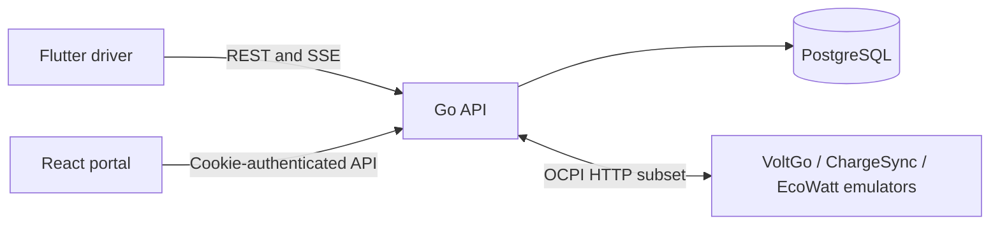

# Architecture and integrity

The Go server is the authoritative boundary for the Flutter driver application,
React operator portal, PostgreSQL database and three simulated CPOs. Clients do
not receive CPO operational credentials or calculate authoritative settlements.

## Boundaries

- Driver `/api/v1` routes use mobile bearer JWTs and owner-scoped records.
- Portal `/admin/api` routes use HttpOnly cookies and CPO/SUPER_ADMIN roles.
- OCPI `/ocpi/emsp` routes use integration tokens and partner identities.
- Registration and connection verification preserve PENDING approval status.
  Only administrators approve marketplace access. Suspended operators cannot
  publish usable stations or begin new driver sessions.
- Push ingestion and periodic pull use shared normalisation/store logic. Pull
  runs every five minutes and can also be invoked during connection verification.

## Pricing and settlement

Tariffs retain source currency and six-decimal precision. Exchange rates are
append-only simulated records. Money uses PostgreSQL NUMERIC and exact decimal
helpers: energy rounds to three places, original cost to two, then wallet cost
to two. An estimate records tariff, FX, estimated energy and spending limit.
It has no time limit and does not reserve money by itself.

At start, the existing transaction locks the wallet, estimate, connector and
tariff; checks ownership, availability, funds and current pricing; and selects
the latest effective FX under the stored source policy. A rate-table SHARE lock
serialises concurrent appends through acceptance. A newer record with the same
numeric rate updates accepted metadata silently. Changed financial terms reject
the start before the remote command. The client obtains a new estimate and asks
for confirmation again.

Acceptance, the PENDING session and wallet reservation commit together. Accepted
financial snapshots are immutable. The gateway sends the remote command; failed
activation releases the reservation. Active telemetry uses the locked basis.
Only a confirmed terminal state supplies a final receipt.

Settlement locks session/wallet records, calculates the original-currency CPO
charge, debits the wallet once, creates one CDR, releases the connector and closes
the reservation in one transaction. A shortfall is explicit platform coverage;
it does not silently reduce CPO revenue. Unique indexes and idempotent terminal
handling prevent duplicate sessions and debits. Durable terminal meter/intent
records let restart recovery finish settlement without restarting a stopped bay.

## Integration scope

The implemented OCPI-oriented subset prefers 2.3.0 and has an explicit 2.2.1
adapter. It covers credentials, locations, tariffs, sessions, commands and CDRs;
it is not certified against the complete specification. Only tax-free energy
tariffs are chargeable. Unsupported time fees, restrictions, taxes and billing
blocks fail closed. All three emulators are Malaysian registered parties with
physical locations in MY, SG and TH; party identity and location country differ.

This local simulation has no connections to real CPOs, vehicle telemetry,
commercial payment gateways, live FX trading or bank payouts. Production
deployment still needs HTTPS, managed credentials, production signing,
monitoring and commercial-network validation.
